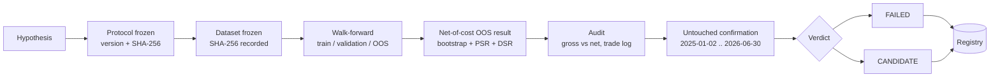

# Case study: a research pipeline that rejects its own strategies

TradingLab is built around one question: **how do you stop a backtest from fooling you?**
This page walks through what the pipeline did to two real strategies on SPY, what it decided,
and, just as important, where the pipeline itself is still weak.

> **Nothing here is evidence of a profitable strategy.** The outcome of the study is two
> *rejections*. That is the point of the tool.

## TL;DR

- A **frozen research protocol** (versioned, hashed) fixes the rules before any run: walk-forward
  windows, 5 bps costs + 2 bps slippage, block bootstrap, PSR and DSR diagnostics.
- Two strategies were run through it on 10 years of daily SPY data. Both ended **FAILED**.
- The second strategy (Donchian breakout) was first marked **CANDIDATE** and then **rejected**
  once a pre-registered untouched-period confirmation was required. Both results stay in the registry.
- Reviewing my own pipeline, I found three process weaknesses (listed below) and the fixes I plan.

## The pipeline



Setup (windows, OOS size, trial count and dataset are recorded in `experiments/registry.csv`; the rest comes from the protocol and the workflow command):

| Item | Value |
|---|---|
| Instrument / data | SPY, daily, 2015-01-01 to 2025-01-01, yfinance |
| Walk-forward | train 756 / validation 252 / test 252 / step 252 trading days, 5 windows |
| OOS sample | 1,260 daily observations (5 x 252) |
| Frictions | 5 bps transaction cost + 2 bps slippage, enforced by the acceptance gate |
| Statistics | moving-block bootstrap, PSR, DSR (Donchian run: block 20, 5,000 samples, 95% confidence) |
| Nominal candidate trials | 20 per run |

## Results

All values below are copied from the registry, which CI writes after each run.

| Run (UTC) | Strategy | Net OOS return | OOS Sharpe | PSR | Verdict |
|---|---|---:|---:|---:|---|
| 2026-09-25 21:47 | Momentum | -0.49% | -0.11 | 0.40 | **FAILED**: aggregate net OOS performance is not positive |
| 2026-09-26 13:46 | Donchian breakout | +45.65% | 0.66 | 0.93 | **CANDIDATE** under the gates at that time |
| 2026-09-27 09:12 | Donchian breakout | +45.65% | 0.66 | 0.93 | **FAILED**: robustness confirmation not confirmed (`incomplete_plateau`) |

How to read it:

- **Momentum** lost money after costs. Rejected by the simplest gate.
- **Donchian** looked good on the headline number, but even as a "candidate" it carried two
  warnings that say it is *not* a statistically established edge: the OOS Sharpe bootstrap
  confidence interval includes zero, and PSR (0.93) is below the 0.95 threshold.
- The confirmation step selects one Donchian lookback from the *development* data (the parameter
  "plateau": every lookback within 80% of the best validation Sharpe, per window) and only then
  tests it on a period that was never used for selection. The study could not freeze a
  lookback (`incomplete_plateau`: at least one development window produced no valid plateau),
  so **the untouched period was never evaluated** and the verdict is FAILED.
- A +45.65% return means little without a buy-and-hold comparison; see "Weaknesses" below.

## Things the pipeline caught or exposed

- **Data drift.** The two Donchian runs have different dataset hashes (the data provider
  returned slightly different history a day later). The OOS return differs only at the sixth
  decimal (0.456505 vs 0.456503), but without the recorded SHA-256 nobody could tell the two
  runs were not on identical data.
- **Cost of a naive implementation.** The generic point-in-time adapter recomputed the full
  Donchian state from every prefix, which is O(N^2) per trial; the robustness study uses a
  linear-time adapter implementing the same rule (commit "make Donchian robustness study linear-time").
- **CI as the lab bench.** A separate workflow runs the test suite, the experiment, the audit,
  the confirmation study, finalizes the verdict and commits the registry.

## Weaknesses I found in my own process

I would rather list these than have a reviewer find them.

1. **A gate was tightened after seeing a result.** All times UTC, 2026-09-26. The confirmation
   study was added at 07:06. The first Donchian result (CANDIDATE) was produced at 13:46 and committed
   to the registry at 13:53. The change "require robustness confirmation for candidate acceptance"
   landed at 15:49. The
   protocol text did not change (the SHA-256 is identical in all three registry rows) because
   the requirement lives in the acceptance code, not in the protocol document. The change made the
   rules *stricter*, and the original result was kept, but the protocol's own immutability rule
   says a change like this should be a new protocol version.
   **Planned fix:** bump to protocol v1.1 and re-register.
2. **The registry is not append-only.** `update_registry_decision` rewrites an existing row,
   and the two Donchian runs share one `run_id`.
   **Planned fix:** unique run ids and append-only decision records.
3. **No benchmark in the registry.** CI builds a Donchian vs buy-and-hold comparison as an
   artifact, but its result is not recorded in the registry, so the headline return cannot be
   judged from the ledger alone.
   **Planned fix:** record the buy-and-hold return and Sharpe over the same OOS windows.

A smaller design note: the plateau rule keeps lookbacks with validation Sharpe >= 0.8 x best.
When the best Sharpe in a window is negative, 0.8 x best is *higher* than best, so nothing is selected
and that window counts as "incomplete". That is a reasonable outcome (no validation edge), but it
should be an explicit rule, not a side effect of the arithmetic.

## Limits of the whole study

- One instrument (SPY), daily data, one 10-year development period.
- Static universe, so no survivorship-bias-free history. See
  [`QUANTITATIVE_VALIDITY.md`](QUANTITATIVE_VALIDITY.md).
- Simplified costs: no market impact, spread dynamics or partial fills.
- DSR uses a nominal trial count. Effective independent trials are not assumed known, and
  undocumented research decisions are not covered by the correction.
- A FAILED verdict means the hypothesis did not pass *this* protocol on *this* data. It does not
  prove the phenomenon never works. A CANDIDATE would not mean "ready to trade".

## Reproduce

Needs network access for the data provider. The sequence below mirrors the
[`quant-experiment`](../.github/workflows/quant-experiment.yml) workflow:

```bash
pip install -r requirements.txt

python experiments/run_experiment.py \
  --symbol spy --start 2015-01-01 --end 2025-01-01 --provider yfinance \
  --strategy donchian --parameter-grid '{"lookback":[20,55,100,200]}' \
  --train-size 756 --validation-size 252 --test-size 252 --step-size 252 \
  --transaction-cost-bps 5 --slippage-bps 2 \
  --bootstrap-samples 5000 --confidence 0.95 --oos-block-length 20

RUN=experiments/results/spy_donchian_2015-01-01_2025-01-01_1d_yfinance
PYTHONPATH=. python experiments/audit_experiment.py --run-dir "$RUN"
PYTHONPATH=. python experiments/robustness_confirmation.py --symbol spy
PYTHONPATH=. python experiments/finalize_acceptance.py \
  --run-dir "$RUN" \
  --confirmation experiments/results/donchian_robustness_study/untouched_confirmation.json \
  --metadata "$RUN/metadata.json"
```

Because the provider's history can change over time, re-running will record a new dataset hash and
may differ slightly from the figures above. The figures in this page are those in
[`experiments/registry.csv`](../experiments/registry.csv).

## Related documents

- [`RESEARCH_PROTOCOL.md`](RESEARCH_PROTOCOL.md): the frozen rules
- [`QUANTITATIVE_VALIDITY.md`](QUANTITATIVE_VALIDITY.md): what the backtester does and does not model
- [`WALK_FORWARD.md`](WALK_FORWARD.md) and [`statistical_inference.md`](statistical_inference.md)
